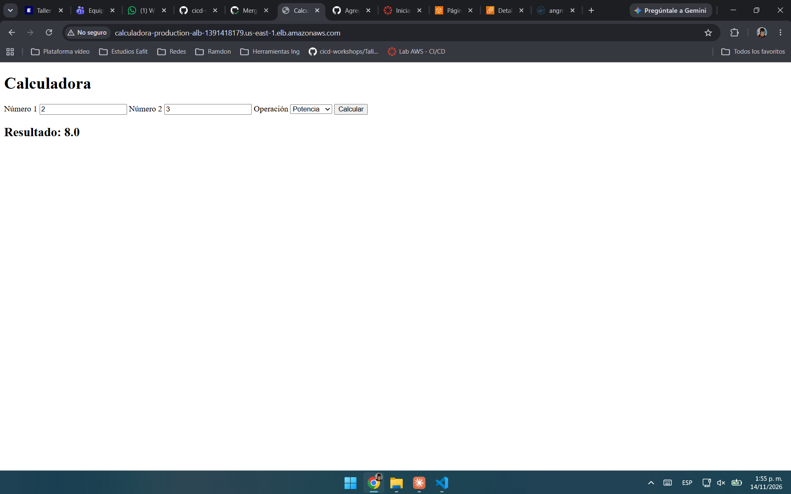
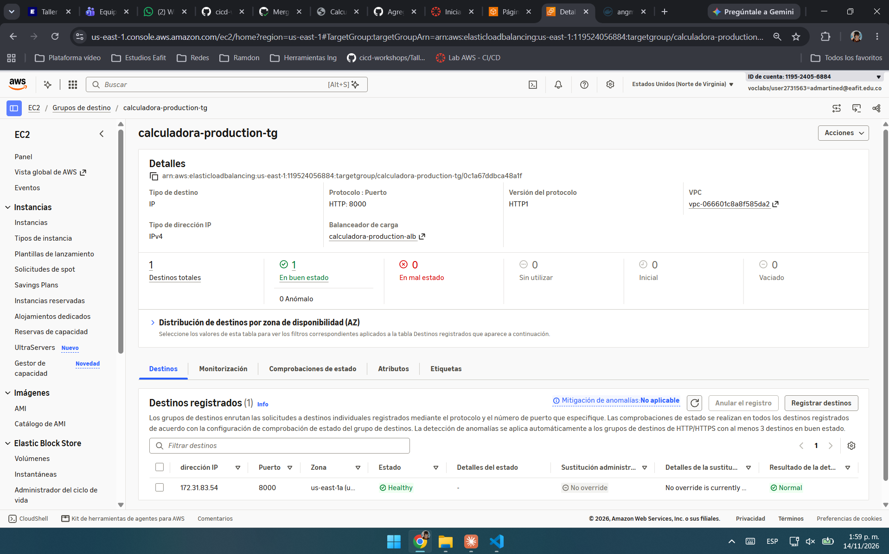

# cicd-pipeline-python-cd

Taller 3 - Despliegue Continuo (CD) con AWS ECS e Infraestructura como Código (Terraform).

## Integrantes

| Nombre completo            | Usuario de GitHub | Rol                         |
| -------------------------- | ----------------- | --------------------------- |
| Angel David Martinez Doria | Angel2327         | Propietario del repositorio |
| Jorge Andres Duran Cotamo  | Jorgeandd10       | Colaborador                 |

## Evidencias

- **Ejecución del pipeline (merge de las nuevas funciones):** https://github.com/Angel2327/cicd-pipeline-python-cd/actions/runs/43628195085
- **Pull Request de las nuevas funciones:** https://github.com/Angel2327/cicd-pipeline-python-cd/pull/2
- **URLs de los ambientes:**

```plaintext
Staging:    http://calculadora-staging-alb-2113252726.us-east-1.elb.amazonaws.com
Production: http://calculadora-production-alb-1391418179.us-east-1.elb.amazonaws.com
```





## Respuestas

### 1. Flujo completo del pipeline

El artefacto que viaja por todo el pipeline es **la imagen Docker etiquetada con el SHA del commit** (`angmtz23/cicd-pipeline-python-cd:<sha>`). Se construye una sola vez y se despliega la misma en Staging y en Producción.

1. **Commit / merge a `main`:** el cambio entra por un Pull Request aprobado (la regla `proteger-main` exige 1 aprobación y el check `build-and-test`). El merge dispara el workflow `CI/CD Pipeline`.
2. **`build-and-test`:** instala dependencias, revisa formato (Black) y lint (Pylint, Flake8), ejecuta las **pruebas unitarias** (funciones de `calculadora.py` aisladas) y **de componente** (rutas de Flask con el cliente de pruebas, incluido `/health`) exigiendo cobertura ≥ 80 %. Valida Terraform (`fmt -check` y `validate`), construye la imagen, la levanta en un contenedor y corre las **pruebas de aceptación** con Selenium contra él (flujo real del usuario en el navegador). Luego analiza el código en SonarCloud (Quality Gate) y, solo en `main`, publica la imagen en Docker Hub con las etiquetas SHA y `latest`. Su salida `image_uri` es la imagen con el SHA.
3. **`deploy-staging`:** con las credenciales de AWS de los secretos, hace `terraform init` contra el estado remoto en S3, selecciona el workspace `staging` y ejecuta `terraform apply` con `image_uri` y `app_version = SHA`. Terraform crea una nueva revisión de la Task Definition y ECS hace un rolling update. Entrega la URL del ALB al siguiente job.
4. **`test-staging`:** espera hasta que `/health` de Staging responda el SHA de esta ejecución (así nunca prueba la versión anterior) y corre las **pruebas de aceptación** de Selenium contra la URL pública de Staging: valida todas las operaciones de punta a punta en un ambiente igual a producción.
5. **Aprobación manual:** el job `deploy-production` usa el ambiente `production`, que tiene revisores requeridos. Queda en *Waiting* hasta que un integrante prueba Staging y aprueba.
6. **`deploy-production`:** igual que Staging pero con el workspace `production` y la **misma** `image_uri` ya probada.
7. **`smoke-test-production`:** espera el SHA en `/health` de Producción y corre las **pruebas de humo**: verifican rápido que la página principal carga y que `/health` responde `ok` con la versión esperada (`EXPECTED_VERSION`).

### 2. Terraform vs. consola manual y estado en S3

**Ventajas:** la infraestructura queda como código versionado en Git y revisable en PRs; es repetible (los mismos `.tf` crean Staging y Producción, solo cambia el workspace); `plan`/`apply` muestran qué va a cambiar antes de hacerlo; y se puede automatizar desde el pipeline y destruir todo con un `terraform destroy`. Crear a mano 9 recursos por ambiente (ALB, Target Group, Listener, Security Groups, Cluster, Task Definition, Servicio, Log Group) sería lento y propenso a errores.

**Desventajas:** curva de aprendizaje de HCL y del manejo de estado; errores menos evidentes (por ejemplo `already exists` si se pierde el estado); depende de los permisos de la cuenta (en el Learner Lab hay que usar `LabRole` y la VPC por defecto); y las diferencias entre shells (en PowerShell hubo que poner `"-backend-config=backend.hcl"` entre comillas).

**¿Por qué el estado en S3?** Porque se despliega desde dos lugares: el computador del propietario y el pipeline, que corre cada vez en una máquina nueva. Si el estado quedara local, el pipeline no sabría que la infraestructura existe e intentaría crearla otra vez. En S3 lo comparten ambos, con bloqueo (`use_lockfile`) para que no haya dos `apply` simultáneos y con versionado para recuperar estados anteriores.

### 3. Ventajas y desventajas del ambiente de Staging

**Ventajas:** permite probar la imagen real en una infraestructura idéntica a Producción (ALB, ECS, red) antes de liberarla; detecta problemas que no aparecen en local (lo vivimos: las pruebas de Selenium pasaban contra `localhost` pero fallaban contra el ALB por HTTP, y lo detectamos en Staging, no en Producción); y da un lugar para la revisión manual previa a la aprobación.

**Desventajas:** más costo (un segundo ALB y otra tarea Fargate, unos USD 1,2 al día), más tiempo de pipeline (un despliegue y una ronda de pruebas extra) y más infraestructura que mantener.

**Velocidad vs. seguridad:** Staging hace el despliegue más lento (el lead time sube varios minutos más el tiempo de aprobación), pero mucho más seguro: una versión defectuosa se queda en Staging y nunca llega a Producción. Para una aplicación con usuarios reales ese costo en velocidad compensa.

### 4. Pruebas contra Staging vs. contra Producción

- **`test-staging`** ejecuta las **pruebas de aceptación** completas con Selenium: abre un navegador, llena el formulario y valida el resultado de cada operación, incluidos los casos de error. Son exhaustivas y tardan más.
- **`smoke-test-production`** ejecuta **pruebas de humo**: solo verifican que la página carga y que `/health` responde `ok` con el SHA esperado, usando la biblioteca estándar (sin navegador). Tardan segundos.

**¿Por qué?** La funcionalidad ya se validó a fondo en Staging con la misma imagen. En Producción solo hace falta confirmar que el despliegue quedó vivo y con la versión correcta, sin generar tráfico de prueba pesado sobre el ambiente de los usuarios ni alargar el tiempo de liberación.

### 5. Partes que aún le faltan al pipeline

1. **Monitoreo, alertas y observabilidad:** hoy solo tenemos logs en CloudWatch y el health check. Faltan métricas y alertas (alarmas de CloudWatch sobre errores 5xx del ALB, latencia y reinicios de tareas, con notificación por SNS o Slack) y dashboards. Es importante porque el ciclo DevOps se cierra con el feedback de producción: sin alertas, un fallo se descubre cuando lo reporta un usuario.
2. **Seguridad de la cadena de suministro e IaC (DevSecOps):** SonarCloud solo analiza `app/` (excluimos `infra/` y `.github/` porque sus hallazgos rompían el Quality Gate). Faltaría escanear la imagen Docker (Trivy o Docker Scout), la infraestructura (Checkov o tfsec), fijar las acciones de GitHub por SHA y usar OIDC en lugar de llaves de AWS en los secretos. Se agregaría como pasos del job `build-and-test` que fallen ante vulnerabilidades críticas.

Otras mejoras: HTTPS en el ALB con un certificado de ACM, y `terraform plan` publicado como comentario en los PRs que cambian `infra/`.

### 6. Experiencia implementando las nuevas funcionalidades

**Angel David Martinez Doria:** Me pareció muy útil que el pipeline hiciera todo después del merge: con un solo PR la nueva operación pasó por pruebas, Staging y Producción sin tocar AWS a mano, y el SHA en `/health` me dejó confirmar qué versión corría en cada ambiente. Lo menos útil fue el tiempo de espera de cada ejecución (15-25 minutos) y que las credenciales temporales del Learner Lab obligan a actualizar los secretos en cada sesión. También tuvimos que ajustar SonarCloud y Selenium para que funcionaran con los archivos de Terraform y con el ALB por HTTP.

**Jorge Andres Duran Cotamo:** Me tocó implementar potencia y módulo y llevarlas hasta Producción. Cambié la cadena de `if/elif` por un diccionario de operaciones para evitar el issue de complejidad cognitiva de SonarCloud, y cubrí los casos de error (módulo por cero y potencias demasiado grandes). Lo más útil fue no desplegar a mano: un merge a `main` bastó para construir, probar, publicar y desplegar la imagen, y con el SHA en `/health` confirmé que Staging y Producción tenían la versión del merge. La aprobación manual y la protección de `main` me dieron confianza, porque probé las operaciones en Staging antes de liberarlas y ningún cambio llega a Producción sin revisión. Lo menos útil fue el tiempo de cada ejecución para cambios pequeños, depender de que la sesión de AWS Academy de Angel estuviera activa y que Chrome forzara HTTPS (HTTPS-First) al abrir el ALB, que solo responde por HTTP; en un proyecto real se resolvería con un certificado HTTPS en el ALB.

### 7. Entrega Continua, revisión en Staging y rollback

Con la aprobación manual, el pipeline implementa **Entrega Continua (Continuous Delivery)**: cada cambio en `main` se construye, se prueba y se despliega automáticamente en Staging, pero el paso a Producción requiere que una persona lo apruebe (*Required reviewers* en el ambiente `production`). Sin esa aprobación sería Despliegue Continuo.

**En Staging revisamos** antes de aprobar: que la página cargara, las operaciones nuevas (potencia `2` y `3` → `8.0`, módulo `10` y `3` → `1.0`, y módulo por cero mostrando el mensaje de error), que las operaciones existentes siguieran funcionando, que `/health` mostrara el SHA del merge y que el job `test-staging` estuviera en verde.

**Si una versión no pasara el health check:** el ALB marcaría la tarea nueva como `unhealthy` y no le enviaría tráfico; ECS la reemplazaría y, tras varios intentos fallidos, el **circuit breaker** marcaría el despliegue como fallido y haría **rollback automático** a la última versión estable. La tarea anterior nunca deja de atender, así que no hay caída. El pipeline lo detecta porque `terraform apply` termina con error (por `wait_for_steady_state`) o, si no, porque el paso de espera de `test-staging` / `smoke-test-production` falla al seguir viendo el SHA anterior en `/health`. Si ocurre en Staging, el pipeline se detiene y la versión defectuosa nunca llega a Producción.
